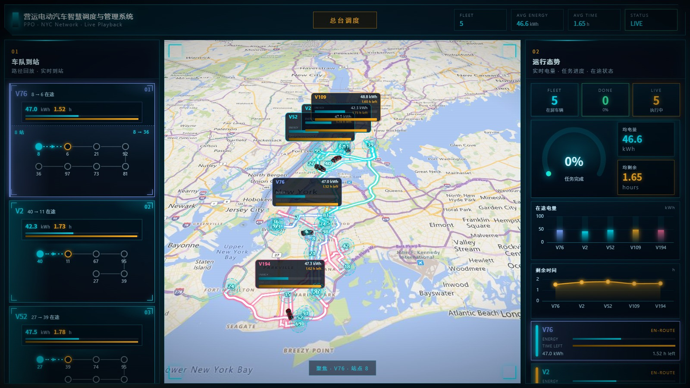
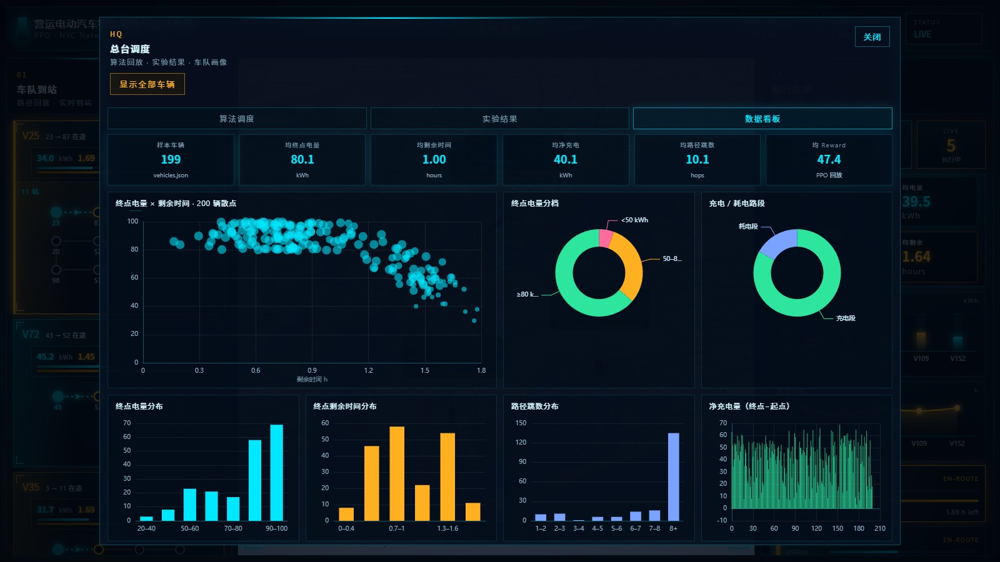

<div align="center">

# Energy Dispatch

### 营运电动汽车智慧调度与管理系统

**把充电调度算法的实验结果，放到一张可以自由漫游的三维地图上回放。**


</div>

---

## 简介

一个面向**营运电动汽车（公共巴士 / 网约车）充电调度**场景的三维可视化演示系统。

调度算法在离线阶段跑出结果（车辆路径、沿途电量与剩余时间、各算法的对比实验表），本系统负责把这些结果**讲清楚**：

- 用 **Cesium** 在真实路网上回放车队行驶过程，电量与剩余时间随车辆前进实时变化；
- 用 **ECharts** 把论文中的实验表做成可筛选、可对比的图表与看板；
- 用一套 **HUD 风格**的界面把「车队到站 — 运行态势 — 总台调度」串成一条信息链。

> 说明：前端不运行算法、不做实时仿真。地图上的每一辆车、图表里的每一个点，都来自仓库中的静态数据。图表里的「实时」是叠加在实验基线之上的演示性扰动，用于模拟监测波动，**不是新的实验结果**。

## 界面预览



<p align="center"><sub>三维地图回放 · 车队到站 · 运行态势</sub></p>



<p align="center"><sub>总台调度 · 数据看板</sub></p>

## 功能特性

### 1. 三维车队回放

- Cesium 三维地球，5 辆车同时沿 OSRM 规划出的真实道路行驶；
- 已行驶路段半透明、未行驶路段发光，分界点随车头位置逐帧推进；
- 站点呼吸光晕、车顶 HUD（电量条 + 剩余时间条）、跟随相机；
- 点击车辆卡片或地图上的车可聚焦 / 跟随，再次点击或右键取消。

### 2. 车队到站面板（左）

每辆车一张卡片：实时电量、剩余时间、进度条，以及地铁线路图风格的站点折线（`MetroZigzag`），一眼看出「从哪来、经过哪几站、到哪去」，状态区分 `EN-ROUTE` / `ARRIVED`。

### 3. 总台调度（右上角按钮）

| 页签 | 内容 |
| --- | --- |
| **算法调度** | 电量 / 剩余时间环形仪表、Reward & Loss 曲线、当前线路的站间速度条形图 |
| **实验结果** | 7 张实验图：车数量 × 能量占比 / 时间占比 / 路径分配率、初始电量 × 能量 / 时间占比、截止时间 × 能量 / 时间占比；可一键开启「实时」演示波动 |
| **数据看板** | 200 辆车终点电量 × 剩余时间散点、电量分档、充电∕耗电路段、两组分布、路径跳数、净充电量、站点访问热力、高频站点 TOP15、算法雷达图与综合得分 |

### 4. 整队 3D 预览

点击「显示全部车辆」，把 50 辆预计算好的车一次性放进独立的 Cesium 场景，每辆车使用 GLB 车辆模型，悬浮 HUD 跟随显示电量与剩余时间。

## 技术栈

| 类别 | 选型 | 用途 |
| --- | --- | --- |
| 框架 | Vue 3（`<script setup>`）+ Vue Router | 单页应用与视图切换 |
| 构建 | Vite 8 + `vite-plugin-cesium` | 开发服务器、生产构建、Cesium 静态资源处理 |
| 三维 | Cesium 1.145 | 地球、影像底图、实体与折线、相机控制 |
| 图表 | ECharts 5 | 实验结果图与数据看板 |
| 路径服务 | OSRM（公共演示服务，经 Vite 代理） | 站间真实道路路径 |
| 规范 | ESLint + oxlint + Prettier | 代码检查与格式化 |

## 快速开始

### 环境要求

- **Node.js** `^22.18.0` 或 `>=24.12.0`（见 `package.json` 的 `engines`）
- 现代浏览器（Chrome / Edge 推荐），需支持 WebGL
- 可访问互联网：Cesium ion 影像底图、OSRM 路径服务

### 安装与运行

```bash
# 1. 获取代码
git clone https://github.com/l-i-k-e123/Energy-Dispatch.git
cd Energy-Dispatch

# 2. 安装依赖
npm install

# 3. 启动开发服务器
npm run dev
```

浏览器打开终端提示的地址（默认 <http://localhost:5173/>）即可。默认从仓库自带的路线缓存中读取 50 条路径，并回放其中的 5 辆演示车；若缓存缺失，会先规划 5 辆车立即开播，其余车辆在后台补算。

### 构建与预览

```bash
npm run build      # 产物输出到 dist/
npm run preview    # 本地预览构建结果
```

## 可用命令

| 命令 | 作用 |
| --- | --- |
| `npm run dev` | 启动开发服务器（含 OSRM 代理与路线缓存写入接口） |
| `npm run build` | 生产构建，产物在 `dist/` |
| `npm run preview` | 预览生产构建 |
| `npm run lint` | oxlint + ESLint 自动修复 |
| `npm run format` | Prettier 格式化 `src/` |

## 目录结构

```text
.
├── docs/
│   ├── 数据说明.md            # 实验数据来源、字段与「实时」扰动公式
│   ├── preview.jpg            # 主界面截图
│   └── preview-dashboard.jpg  # 总台调度截图
├── public/                    # 静态资源，构建后原样拷贝到站点根目录
│   ├── cl_data/
│   │   ├── chapter2/          # 论文实验表（7 组曲线）与实时扰动参数
│   │   ├── fleet_routes.json  # 50 辆车的路线缓存（自动生成）
│   │   └── vehicles.json      # 200 辆车的路径 / 电量 / 时间 / 回报
│   ├── modles/
│   │   └── mitsubishi_evo.glb # 车辆 3D 模型
│   ├── zhandain/
│   │   ├── data.csv           # 100 个站点坐标
│   │   └── speed.csv          # 100×100 站间速度矩阵
│   └── favicon.ico
├── src/
│   ├── components/
│   │   ├── AnalyticsDashboard.vue  # 数据看板
│   │   ├── ExperimentCharts.vue    # 实验结果图表
│   │   ├── FleetMiniCharts.vue     # 运行态势小图
│   │   ├── FleetModelsDialog.vue   # 整队 3D 预览
│   │   └── MetroZigzag.vue         # 站点折线图
│   ├── router/index.js
│   ├── utils/
│   │   ├── analyticsData.js   # 车队统计指标
│   │   ├── demoVehicles.js    # 站点 / 车辆 / 速度矩阵、车选、OSRM 取路
│   │   ├── fleetCache.js      # 路线缓存读写与形状保持抽稀
│   │   ├── stationHalo.js     # 站点光晕 Canvas
│   │   └── vehicleHud.js      # 车顶 HUD Canvas
│   ├── views/HomeView.vue     # 主视图：地图 + 面板 + 调度台
│   ├── App.vue
│   └── main.js
├── index.html
├── package.json
├── vite.config.js             # 别名、OSRM 代理、路线缓存写入中间件
├── LICENSE
└── README.md
```

## 数据说明

业务数据全部放在 `public/` 下，构建后原样拷贝到站点根目录。字段级说明见 [docs/数据说明.md](docs/数据说明.md)。

### 站点与路网 `public/zhandain/`

| 文件 | 内容 |
| --- | --- |
| `data.csv` | 100 个站点，每行 `lat,lon`；**行号即站点编号**（从 1 开始） |
| `speed.csv` | 100×100 站间车速矩阵（km/h）。`0` 表示该方向不可通行，前端会用稳定的伪随机值兜底（约 20–55 km/h），避免车辆卡死 |

### 车辆与路线 `public/cl_data/`

| 文件 | 内容 |
| --- | --- |
| `vehicles.json` | 200 辆车：`path`（站点序列）、`energy`（沿途电量 kWh）、`time`（剩余时间 h）、`rewards` / `losses` |
| `fleet_routes.json` | 路线缓存：`v`（缓存版本）、`demoIds`（演示车）、`items`（50 辆车的站点序列、抽稀后的经纬度、电量与时间序列） |

`fleet_routes.json` 由开发服务器在首次运行时自动生成：调用 OSRM 取真实路径 → 形状保持抽稀（最多 360 点）→ 写回文件。之后启动直接读缓存，省掉几十次网络请求。删除该文件即可强制重新规划。

### 实验结果 `public/cl_data/chapter2/`

从论文实验表导出的 7 组曲线，算法为 `Dijkstra` / `DQN` / `PPO` / `PPO+DP` / `SEA`：

| 文件 | 图表 |
| --- | --- |
| `fleet_energy.json` / `fleet_time.json` | 能量 / 时间占比 × 车数量（25→200） |
| `init_energy.json` / `init_time.json` | 能量 / 时间占比 × 初始电量（1.0→1.7） |
| `deadline_energy.json` / `deadline_time.json` | 能量 / 时间占比 × 截止时间（1.0→1.7 h） |
| `fleet_alloc.json` | 路径分配率 × 车数量 |
| `index.json` | 图表分组与标题 |
| `live_params.json` | 「实时」按钮使用的演示扰动参数 |

## 实现要点

1. **一次规划，长期复用。** `fleetCache.js` 用 Douglas–Peucker 抽稀（按米级容差逐步放宽）压缩路线，既保住弯道形状，又把每条路径压到几百个点；缓存带版本号，版本不匹配自动失效。
2. **回放靠 Cesium 时钟。** 位置用 `SampledPositionProperty` 按路径采样并通过 `ExtrapolationType.HOLD` 兜底端点；行进时长 = 路径长度 ÷ 40 m/s（`DEMO_SPEED_MPS`），时钟倍速 2 倍循环播放。
3. **每车只挂两条折线。** 已走 / 未走各一条贴地 `polyline`，每帧把车辆投影到路线上、原地替换坐标数组，避免频繁重建实体。
4. **Canvas 替代 DOM。** 站点光晕与车顶 HUD 都在离屏 canvas 上绘制，再作为 billboard 贴图，省掉逐帧的 DOM 重排。
5. **分级降级。** Cesium ion 底图不可用 → 回退 OSM 瓦片；OSRM 不可用 → 回退站间直线加密。弱网或服务限流时不至于卡死。
6. **先看后算。** 缓存缺失时先规划 5 辆演示车并立即开播，剩余 45 辆以后台并发 2 逐辆补算，全部就绪后才解锁「显示全部车辆」。

## 注意事项

### Cesium ion Token

`src/views/HomeView.vue` 中内置了一个演示用的 `Cesium.Ion.defaultAccessToken`。该 Token 会随前端产物一起下发，**无法保密**，正式部署时请替换为自己的：

1. 在 <https://ion.cesium.com/tokens> 申请 Token；
2. 替换代码中的常量，或改为读取环境变量：

   ```js
   Cesium.Ion.defaultAccessToken = import.meta.env.VITE_CESIUM_ION_TOKEN
   ```

Token 失效时影像底图会自动回退到 OpenStreetMap 瓦片，功能不受影响。

### 常见问题

| 现象 | 原因与处理 |
| --- | --- |
| 地图一片空白 / 报 WebGL 错误 | 浏览器硬件加速被关闭或显卡驱动过旧；开启硬件加速或更新驱动 |
| 启动较慢 | 缓存缺失或版本不匹配时需要重新调用 OSRM 规划 50 条路线，公共演示服务有限流；等状态变为 `LIVE` 即可，缓存生成后下次秒开 |
| 一直停在「加载数据…」 | 检查网络能否访问 OSRM 与瓦片服务；控制台若出现 429，说明被限流，可稍后重试 |
| 缓存没有生成 | `/__save_fleet_cache` 只存在于 `npm run dev` 的开发服务器，`npm run build` 产物没有后端，删除缓存后需重新以开发模式跑一次 |
| 端口被占用 | Vite 会自动递增端口；想固定端口用 `npm run dev -- --port 5173 --strictPort` |

### 版权与署名

- 影像底图由 **Cesium ion** 与 **OpenStreetMap** 提供，路径规划由 **OSRM** 提供，使用请遵守各自服务条款；
- 代码中隐藏了右下角版权条（credit）以适配 HUD 视觉，**对外发布或商用前请恢复相应署名**；
- `public/modles/mitsubishi_evo.glb` 仅作演示，模型版权归原作者所有。

## 贡献

欢迎提交 Issue 与 Pull Request。提交前请先执行 `npm run lint`，确保 oxlint 与 ESLint 均无报错。

## 许可证

本项目基于 [MIT License](LICENSE) 开源。
